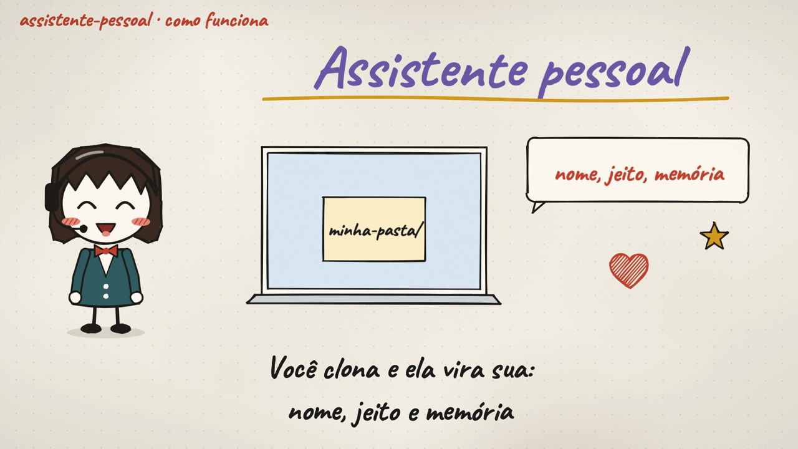

# Assistente pessoal

[](docs/como-funciona.mp4)

**[▶ Assista ao vídeo: como funciona (~2 min)](docs/como-funciona.mp4)**

Uma assistente pessoal com nome, personalidade e memória próprios, que mora numa pasta do seu computador e funciona com o **ChatGPT (Codex)**, o **Claude (Claude Code)** ou o **Gemini (Antigravity)**. Você clona, abre a ferramenta na pasta, e na primeira conversa ela se apresenta, explica como funciona e deixa você escolher o nome dela, o jeito de falar, o modelo e o que mais ela vai poder fazer.

## O que ela é

- **Tem personalidade e não concorda com tudo.** Faz o trabalho prático, aponta o furo do plano com respeito, e depois respeita a sua decisão.
- **Lembra das coisas.** A memória fica em arquivos `.md` curtos, com um índice de uma linha por item. Nada some quando a conversa acaba, e você pode ler e corrigir tudo.
- **Tem uma "alma".** O arquivo `memoria/alma.md` guarda o jeito dela, as opiniões e o que ela aprende sobre si mesma.
- **Sabe os limites.** Faz sozinha o que é seguro (ler, escrever nesta pasta, pesquisar). Pede o seu ok para mandar mensagem, gastar, instalar, apagar ou publicar. Nunca lê segredos.
- **Delega** para subagentes quando a ferramenta tem, e avisa antes quanto vai gastar.
- **Cresce só se você quiser.** Voz, vários computadores, rotinas automáticas, lembretes, notificações, ligação com o [cérebro pessoal](https://github.com/hackermannjon/cerebro-pessoal): nada vem instalado. No onboarding ela pergunta o que você quer e, para cada item, diz o custo, o que instala e quanto tempo leva antes de pedir o ok.

## Como funciona (os arquivos)

```
AGENTS.md            regras (fonte única). O Codex e o Antigravity leem este arquivo.
CLAUDE.md            importa o AGENTS.md (@AGENTS.md) + notas só do Claude
GEMINI.md            importa o AGENTS.md + notas só do Gemini
config/assistente.json   nome, tom, idioma, modelo, capacidades ligadas, "onboarding_feito"
memoria/
  MEMORIA.md         índice: um item por linha
  alma.md            quem ela é (ela mesma atualiza)
  diario.md          o que ela fez, uma linha por ação
  _modelo.md         modelo de arquivo de memória
guias/
  ONBOARDING.md      roteiro da primeira conversa
  LIMITES.md         o que faz sozinha, o que pede ok, o que nunca faz
  APAGAR-TUDO.md     roteiro do botão de emergência
  MODELOS-E-CUSTOS.md  qual modelo usar, limites dos planos, economia de contexto
  capacidades/       passo a passo de cada capacidade opcional
trabalho/            o que ela cria para você (planos, pesquisas, páginas)
estado/criados.md    o que ela criou fora da pasta (para o "apagar tudo")
.claude/commands/, .gemini/commands/  atalho /apagar-tudo
.claude/settings.json  fixa o Sonnet no Claude Code (o padrão do Pro é o Opus)
```

**Uma fonte de regras, três ferramentas.** O `AGENTS.md` é o padrão aberto que o Codex lê. O Claude Code lê o `CLAUDE.md`, que aqui só tem a linha `@AGENTS.md` (import) e as notas do Claude. O Antigravity lê o `AGENTS.md` direto; o `GEMINI.md` existe para quem ainda usa o Gemini CLI, que importa com a mesma sintaxe. Mudou uma regra? Mude no `AGENTS.md`. Diferenças:

| | Lê | Import de arquivo | Limite de tamanho |
|---|---|---|---|
| Codex (ChatGPT) | `AGENTS.md`, da raiz até a pasta atual | não documentado (por isso o AGENTS.md é a fonte) | 32 KiB somados |
| Claude Code | `CLAUDE.md` (lê `AGENTS.md` só se não houver CLAUDE.md) | `@caminho`, até 4 níveis | — |
| Antigravity (Gemini) | `AGENTS.md` ou `GEMINI.md` | `@[rótulo](caminho)` | 24.000 bytes por arquivo |
| Gemini CLI | `GEMINI.md` (configurável) | `@arquivo.md` | — |

**Primeira sessão.** O `config/assistente.json` vem com `"onboarding_feito": false`. Enquanto estiver assim, a regra do `AGENTS.md` manda a assistente seguir o `guias/ONBOARDING.md` antes de qualquer coisa: ela se apresenta, explica as regras, oferece nomes, pergunta o que mudar (nome, personalidade, modelo, idioma, regras), aplica nos arquivos, mostra a lista de capacidades opcionais e só então marca `true`.

## Requisitos

- Uma das três ferramentas, com a conta do seu plano:
  - **ChatGPT Plus** (ou superior) com o Codex: app desktop do ChatGPT no modo Codex, ou o Codex CLI. **Caminho recomendado.**
  - **Claude Pro** (ou superior) com o Claude Code.
  - **Google AI Pro** ou conta Google gratuita com o Antigravity CLI.
- `git` para clonar. Python 3 só se você ligar capacidades que usem script.
- Mac, Windows ou Linux.

## Começar

```bash
git clone https://github.com/hackermannjon/assistente-pessoal.git minha-assistente
cd minha-assistente
```

Depois, abra na sua ferramenta e diga "oi". Ela começa o onboarding sozinha.

### ChatGPT / Codex (recomendado)

- **App desktop do ChatGPT (mais fácil):** instale o app ([learn.chatgpt.com/docs/app](https://learn.chatgpt.com/docs/app)), entre com a sua conta, escolha o modo **Codex**, abra a pasta `minha-assistente` como projeto e mande "oi". O app tem botões de permissão, voz e tarefas agendadas (úteis para as rotinas).
- **Codex CLI (terminal):** instale (`curl -fsSL https://chatgpt.com/codex/install.sh | sh`, ou pelo npm/Homebrew: veja [a página do CLI](https://learn.chatgpt.com/docs/cli)), entre com `codex` e escolha a conta do ChatGPT. Na pasta: `codex`. Para trocar de modelo: `/model`.

### Claude Code

Instale ([code.claude.com](https://code.claude.com/docs/en/setup)), e na pasta rode `claude`. O repositório já fixa o Sonnet; para uma análise pesada, `/model opus`, e volte com `/model sonnet`.

### Gemini (Antigravity CLI)

Desde junho de 2026, quem usa conta Google gratuita ou Google AI Pro usa o Gemini no terminal pelo Antigravity CLI: `curl -fsSL https://antigravity.google/cli/install.sh | bash` (Windows: veja [a página de instalação](https://antigravity.google/docs/getting-started?tab=cli)). Na pasta: `agy`. O Gemini CLI antigo (`gemini`) continua funcionando para chave de API paga e lê o `GEMINI.md`.

## Custos e modelos (resumo)

Consultado em 20/11/2026; o detalhe, as fontes e a parte de contexto estão em [`guias/MODELOS-E-CUSTOS.md`](guias/MODELOS-E-CUSTOS.md).

| | Dia a dia | Análise pesada (rara) | Rotina automática | Ver consumo |
|---|---|---|---|---|
| ChatGPT Plus (Codex) | GPT-6.2 Sol, esforço baixo/médio | GPT-6.2 Astra, comece em baixo/médio | GPT-6 Luna | `/status` |
| Claude Pro (Claude Code) | Sonnet | Opus, com parcimônia | Haiku | `/usage` |
| Gemini (Antigravity) | Gemini Flash | Gemini Pro (Neon) | Gemini Flash | `/usage` |

- Os três planos básicos têm **janela de uso de 5 horas** e **limite semanal**. No Plus, a OpenAI estima de 17 a 180 mensagens por janela com o GPT-6.2 Sol e de 6 a 50 com o Astra.
- **Nunca** use o modelo mais forte em rotina automática ou em loop.
- **Contexto:** regras e memórias curtas; índice com um item por linha; `/compact` quando a conversa ficou longa no mesmo assunto; sessão nova (`/new` ou `/clear`) quando o assunto mudou. Antes, peça "grava o que importa".

## Como personalizar

Tudo é texto e é seu. Duas formas:
1. **Pedindo a ela:** "muda o seu tom para mais gentil", "pode criar arquivos na pasta X sem me perguntar", "liga a voz", "refaz o onboarding". Ela aplica no arquivo certo.
2. **Editando:** nome e preferências em `config/assistente.json`; regras e personalidade-base no `AGENTS.md`; jeito e gostos dela em `memoria/alma.md`; limites em `guias/LIMITES.md`; capacidades em `guias/capacidades/`.

## Apagar tudo (botão de emergência)

Escreva **"apague tudo"** na conversa (vale "apaga tudo" ou "delete tudo"; no Claude Code e no Gemini CLI também há o atalho `/apagar-tudo`). Ela mostra o que vai sumir e pede para você responder **APAGAR**; qualquer outra resposta cancela. Confirmado, ela:

1. desfaz o que criou fora da pasta e anotou em `estado/criados.md` (tarefas agendadas, programas que instalou, modelos de voz, pastas);
2. volta a pasta ao estado de recém-clonada (`git reset --hard` para a tag `origem-do-clone` + `git clean -fdx`; a pasta `.git` fica);
3. lista, com o passo exato, o que só você pode apagar: o histórico das conversas na ferramenta (Claude Code, Codex, Gemini) e itens como um repositório de backup.

Não use `/clear` para isso: é um comando da ferramenta que só limpa a conversa. Roteiro completo em [`guias/APAGAR-TUDO.md`](guias/APAGAR-TUDO.md).

## Privacidade

A memória fica nos arquivos desta pasta. Se você for guardar a sua cópia no GitHub, **crie o repositório como privado**. Nunca faça push da sua memória para um repositório público. O `.gitignore` já deixa de fora `.env*` e chaves.

## Licença

[MIT](LICENSE).
